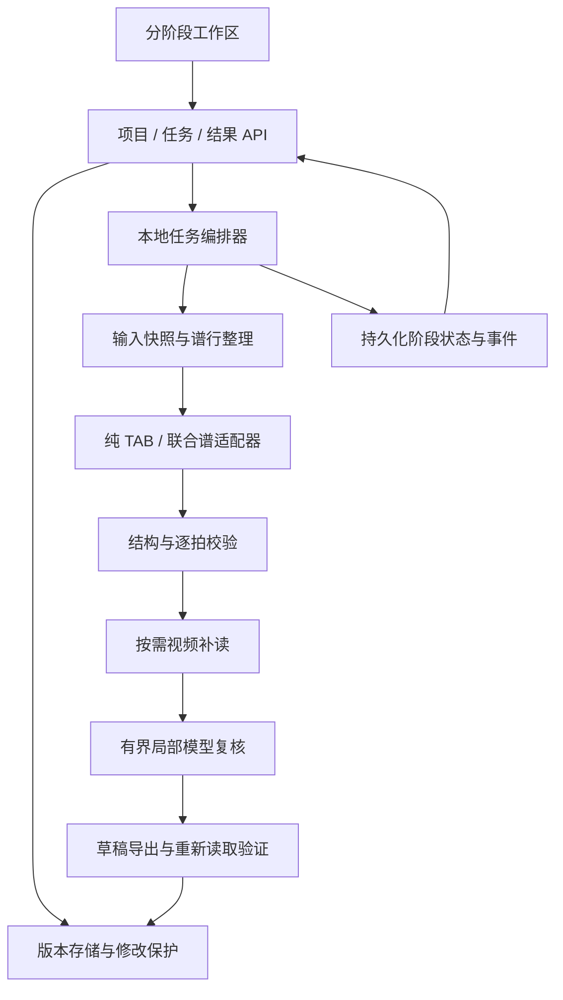

# 视频 / PDF 转 GP5 技术设计

版本：1.0 · 2026-10-23  
依据：[PRD](PRD.md) · 基线：`v0.2.0-preview.1`  
状态：目标设计，已进入实施。实际接口、存储与保守策略以代码及 [实施记录](IMPLEMENTATION_STATUS.md) 为准；本文仍包含尚未交付的扩展设计。

## 1. 技术目标与取舍

在既有 React / TypeScript / Vite、FastAPI / Pydantic、OpenCV / RapidOCR、PyGuitarPro 和文件存储基础上实现自动转谱流程。不引入账号、云端数据库、消息队列或新的前端组件框架。先完成本地单服务可靠运行，再考虑分布式任务。

核心约束：纯 TAB 与联合谱读取器分离；任务结果版本化；人工修改受保护；局部失败仍可产出明确标注的草稿；GP5 导出不修改识别源数据。

## 2. 已核实的代码结构与问题

| 现有位置 | 职责 | 改造方向 |
| --- | --- | --- |
| `frontend/src/pages/Workspace.tsx` | 项目恢复、视频预览、处理及左右布局 | 分阶段工作区及共享项目上下文 |
| `frontend/src/components/ScorePanel.tsx` | 识谱配置、调用、校对、下载 | 拆分任务、结果、疑点、编辑及设置组件 |
| `backend/app/api/routes.py` | 视频处理、进度，后台线程 | 接入统一项目任务锁与编排适配层 |
| `backend/app/api/score_routes.py` | PDF、谱行、识别、修复、导出 | 保留旧 API；新编排与版本 API 使用薄路由 |
| `local_tab_reader.py` | 原纯 TAB 读取 | 保留独立入口与回归集 |
| `combined_local.py`、`notation_graph.py` | 联合谱读取与关联 | 局部改进，输出更完整的定位证据 |
| `score_continuity.py`、`video_score_recovery.py` | 拼接、视频补读 | 包装为有界阶段，保留输入 / 输出快照 |
| `local_review.py`、`model_repair.py` | 局部复核 | 接入疑点队列、补丁审计及修改保护 |
| `diagnostic_export.py`、`score_exporter.py` | 诊断与常规 GP5 | 统一产物清单，保持严格导出的独立规则 |
| `backend/app/models/score.py` | 严格校验的乐谱模型 | 用版本包承载新增元数据，避免直接破坏旧数据 |

当前视频任务和识谱任务有不同的状态与锁；识谱使用进程内 `_busy`，不能直接代表重启后的任务状态。`prepare()` 会清空当前 `score.json`，新流程必须先隔离输入版本，禁止对已有人工作业的目录原地准备。现有谱面模型拒绝额外字段，新元数据不能直接写入旧模型后假定可读取。

## 3. 目标架构



建议新增 `conversion_pipeline.py`、`job_runner.py`、`revision_store.py`、`issue_service.py`、`patch_service.py`、`artifact_service.py`。这些是职责边界，可在实现时合并小模块，但不得把全部逻辑继续堆入路由。

读取器通过适配器返回现有 Score、片段及 sidecar 证据。自动补读和模型均产出候选补丁，不直接写活动乐谱。

## 4. 持久化模型

### 4.1 版本包

每次输入区域 / 类型确认、重识别或人工保存产生可追溯版本。建议布局：

```text
score/v2/
  project-state.json              # 当前输入、活动结果及任务指针
  inputs/<input_id>/manifest.json # 源文件引用、hash、区域、类型、谱行与变换
  jobs/<job_id>/state.json        # 状态、输入版本、阶段检查点、错误
  jobs/<job_id>/events.jsonl      # 脱敏事件；不能作为唯一恢复依据
  revisions/<revision_id>/
    revision.json                # schema_version、父版本、来源、保护字段
    score.json                   # 与现有 Score 兼容的音乐数据
    entities.json                # 稳定标识、图像证据与来源坐标
    issues.json                  # 结构化疑点
    patches.json                 # 修改记录及接受 / 拒绝原因
  artifacts/<artifact_id>/
    manifest.json                # 对应版本、类型、hash、生成状态
    draft.gp5
    issues.json
```

原始视频、PDF、帧文件继续沿用现有存储；新版本只引用不变素材，避免复制整段视频。派生图像可按内容 hash 复用。输出文件名不可由任意用户路径决定。

### 4.2 核心实体

| 实体 | 必需信息 |
| --- | --- |
| InputSnapshot | 输入 hash、区域、layout、渲染与读取版本、谱行来源及筛选状态 |
| Revision | ID、父 ID、输入 ID、产生方式、时间、音乐数据 hash |
| EntityMap | measure_id、beat_id、note_id、画面顺序、印刷编号、来源坐标 |
| SourceRef | 文件 ID、页码 / 时间、谱行 ID、原图 bounds、缩放 / 拼接变换 |
| Issue | ID、类型、严重性、实体 ID、原因、候选、证据、处理状态 |
| Patch | 基础版本、目标 ID、字段、原值、新值、作者类型、证据与判定 |
| Artifact | ID、版本 ID、GP5 / 报告路径、完整性、占位清单、验证结果 |

内部 ID 与印刷小节编号分开。拼接导致实体变化时保留旧 ID 到新 ID 的映射；不能只用数组索引定位修改。旧版本首次导入分配 ID 并保存映射，不能每次加载重新生成。

Issue 类型至少包括 pitch、duration、tie_or_technique、fragment_gap、number_conflict、settings_unconfirmed、ocr_notice。严重性与草稿可写状态分开。时间长度校验继续采用精确有理数，不使用浮点累加判断拍数相等。

## 5. 任务编排与生命周期

### 5.1 状态

任务状态：`queued → running → completed | partial | failed | cancelled | interrupted`。取消时先为 `cancelling`。阶段独立记录 prepare、read、validate、recover、review、export。

`completed` 表示计划流程执行结束，不表示音乐完全准确；`partial` 表示有合法产物但部分阶段未完成。是否可下载由 artifact 决定，不能仅从任务状态推断。

单项目最多一个自动写任务；人工可以编辑已有版本。编辑后，任务仍基于启动快照生成独立结果，不自动把陈旧结果设为活动版本。新版本的应用检查当前活动版本是否仍等于任务的基础版本。

### 5.2 阶段规则

1. 建立输入与基础结果快照，验证区域和类型；不覆盖旧 `score.json`。
2. 整理谱行、过滤和拼接；记录被过滤项、片段、编号冲突与来源。
3. 选择独立读取器，保留确定拍位和不确定候选。
4. 校验并生成去重的结构化疑点；音高、时值与结构分别评估。
5. 有原视频且存在可定位疑点时查找其他画面；仅应用证据充分的补丁。
6. 剩余适用疑点进入模型队列；无配置跳过，不影响本地结果。
7. 生成 GP5 与问题报告，重新读取验证后原子发布 artifact。

读取阶段结束可先发布基础草稿；后续补读 / 模型完成后发布新的版本和草稿，旧下载不失效。界面明确“当前草稿”与“仍在复核”，避免等待模型才首次拿到文件。

### 5.3 中断、锁与预算

- 初期采用单 Uvicorn worker、进程内项目锁及持久化任务状态；所有新旧写入口共用项目锁。多 worker 不在本阶段支持范围。
- 服务重启把未结束任务标为 interrupted；用户继续时从已完成检查点新建任务，不重复应用已有补丁。
- 阶段完成先持久化产物再更新指针；临时文件同目录唯一命名并 replace。JSONL 尾行损坏不影响 state 恢复。
- CPU 识谱放入受限工作进程，供硬超时和取消使用；轻量协调线程不能被同步模型请求长期占用。
- 初始建议：同一疑点最多 2 次模型请求，单请求 90 秒，总复核预算 10 分钟，模型并发 1；这些是可调工程默认值，须用本机基准修订。
- 本地长循环在谱行 / 小节边界检查取消；外部进程设置超时和终止清理。取消后停止派发新工作，已发布草稿保留。
- 幂等键绑定项目、输入、参数和基础版本；重复点击返回相同活动任务，明确“强制重跑”才创建新任务。

## 6. 补丁接受与人工保护

每项补丁校验目标 ID、基础版本、原值及字段白名单；禁止模型随意增加 / 删除小节或改变整曲编号。允许的局部字段包括品位、弦号、时值、附点、延音等，结构拼接交给独立规则处理。

接受条件包含数据范围合法、来源可对应、未破坏已确定内容、未引入结构问题，以及修改证据与字段匹配。总拍数改善是辅助依据；原本拍数恰好正确也可能有错，不能把“保持拍数”当作唯一限制。

人工编辑的字段锁定；旧式 reviewed 小节保守保护整小节。自动候选碰到保护项时只记录建议。用户主动应用建议产生新人工版本。修改、撤销和重新运行均保留父版本链。

## 7. 草稿导出

草稿生成使用结果副本，不清除源数据的 unresolved 字段。已知音符照常写入；候选写入时添加 CHECK 标记并在报告保留候选来源。

不能表达的片段使用明确的缺失占位，仅限维持文件结构所需，附独立类型标识。原图确认的休止符与占位休止必须在报告和 GP5 小节标记中可区分。未知时值引起的节奏变化必须提示，不能宣称占位后的播放节奏准确。

导出后使用 PyGuitarPro 重新读取，核对曲目、音轨、小节顺序、音符及预期可编码时值；出现无法编码的小节记录降级原因。有可用片段尽量保留，完全不可写则返回明确错误。GP5 不适合承载完整证据，问题 JSON / 可阅读报告作为配套产物。

严格导出保持现有检查，放在次级入口；默认草稿下载不再依赖 settings_confirmed、reviewed 或普通 OCR 分数全部通过。

## 8. API 契约（拟新增）

统一前缀 `/api/projects/{project_id}`，保留现有 API。在接口实现前用类型和契约测试固定请求响应。

| 方法及路径 | 语义 |
| --- | --- |
| POST `/conversion-jobs` | 输入引用、layout、ROI、基础版本、幂等键；202 返回 job_id |
| GET `/conversion-jobs/{job_id}` | 状态、阶段、计数、耗时、当前草稿、可恢复标识 |
| POST `/conversion-jobs/{job_id}/cancel` | 请求取消，幂等返回任务状态 |
| POST `/conversion-jobs/{job_id}/resume` | 从检查点新建任务，保留原任务 |
| GET `/revisions`、GET `/revisions/{id}` | 版本摘要 / 音乐数据及来源 |
| POST `/revisions/{id}/edits` | expected_revision、字段补丁；成功产生新版本 |
| POST `/revisions/{id}/activate` | 显式选择活动版本；需 expected_revision |
| GET `/revisions/{id}/issues` | 按类型 / 状态筛选，可分页 |
| GET `/sources/{source_id}/preview` | 受控来源图与坐标元数据 |
| POST `/revisions/{id}/artifacts` | 新建或复用导出任务，不在 GET 内写结果 |
| GET `/artifacts/{id}` | 状态、版本及下载地址 |
| GET `/artifacts/{id}/download` | 只读文件下载 |

409 表示任务 / 编辑冲突并返回可读原因；422 表示输入不合法；404 表示项目 / 版本 / 产物不存在。错误体统一含 code、message、可选 issue_id / retryable，前端不能只显示 HTTP 状态。

前端初期使用带退避的轮询；请求按 job_id 与 revision_id 过滤，切换项目清理定时器。旧请求返回不能覆盖新项目或新版本。

## 9. 前端状态与拆分

组件结构遵循 [UI 文档](UI_DESIGN.md)：WorkspaceShell、PreparationView、ConversionView、ResultsView；SourceCanvas、IssueQueue、MeasureEditor、DraftSummary、SettingsDrawer、VersionMenu 为分工组件。

用 React hooks / reducer 管理项目、任务和编辑状态，暂不引入全局状态库。服务端是版本和任务真值；localStorage 只记最近项目、主题与视图偏好。未保存编辑显式标记，切换时提供保存 / 放弃 / 留在当前页。

ROI 存原图坐标，预览使用 ResizeObserver 计算变换；pointermove 只更新本地绘制，pointerup / 数值确认后保存，开始任务前等待最后一次保存完成。不保留固定 800px 作为布局前提。

## 10. 缓存、运行与隐私

缓存键包含输入内容 hash、ROI、layout、谱行变换、算法版本、影响结果的设置；模型缓存额外包含模型标识、提示模板版本和候选上下文。人工补丁不进入跨项目识别缓存。缓存失效不能删除已有版本。

默认绑定 127.0.0.1；新 API 文件 ID 校验、路径限制及上传限制与现有规则一致。日志不记录密钥、完整模型鉴权头。兼容远程接口启用前说明图片会发送到所配置服务；不把外部模型地址误称为全本地处理。

单独记录阶段时间、缓存命中、模型预算消耗、补丁接受 / 拒绝及占位数量；不把 OCR 分数转成未经校准的“准确率”。

## 11. 兼容迁移与回退

旧项目首次使用新流程时只读导入并备份；原目录及下载保持不变。迁移有版本标识、完成记录和重复执行保护，失败不改变活动指针。不得让旧 prepare 路由清空新活动版本。

第一轮通过功能开关启用新工作区 / 编排器，旧界面作为短期回退路径；不能让两套写逻辑并发操作同一活动版本。代码回退时旧版本读取旧目录，新数据保留但不强制喂给旧模型。

## 12. 验证策略

- 单元：有理数节奏、稳定 ID、问题分类、补丁保护、缓存失效与占位标记。
- 集成：双击启动、任务 / 编辑冲突、取消 / 超时、重启恢复、原子写失败、迁移重复执行。
- 识谱回归：两种谱面、跨行、双位品位、延音、截断音符与真实休止；调试与验收样本分离。
- 导出：候选 / 占位 / 正常音符往返读取，实际 Guitar Pro 打开与播放核对。
- 前端：项目切换的陈旧响应、未保存编辑、ROI 缩放、任务轮询清理、草稿就绪仍在复核。
- 数据保护：对素材和用户修改做前后 hash / 字段对比；失败与升级路径不得静默覆盖。

测试投入集中在数据保护、异步状态和音乐结果，视觉间距及文案采用浏览器检查，不为每条 CSS 写镜像测试。
